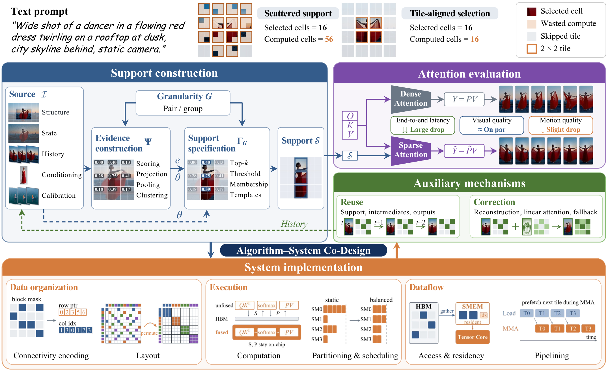

# Awesome Sparse Attention for Visual Generation

Companion repository for **Sparse Attention for Visual Generation: Toward Algorithm–System Co-Design**. The reading list follows the survey’s **4+1+3** framework, from selecting query–key pairs to executing sparse workloads on hardware.

[arXiv](https://arxiv.org/abs/2611.21029) · [PDF](https://arxiv.org/pdf/2611.21029) · [Full text](https://arxiv.org/html/2611.21029v1) · [BibTeX](#cite-the-survey) · [Contribute](CONTRIBUTING.md)

## Contents

- [Start here](#start-here)
- [The 4+1+3 framework](#the-413-framework)
- [Static sparse attention](#static-sparse-attention)
- [Dynamic sparse attention](#dynamic-sparse-attention)
- [Auxiliary mechanisms](#auxiliary-mechanisms)
- [Algorithm–system co-design](#algorithmsystem-co-design)
- [Evaluation benchmarks and metrics](#evaluation-benchmarks-and-metrics)
- [Open research questions](#open-research-questions)
- [Applications](#applications)
- [Additional references](#additional-references)
- [Cite the survey](#cite-the-survey)

## Start here

These papers illustrate the main design choices in the [framework](#the-413-framework). Each implementation link points to a repository published by the paper’s authors or project team.

| Method | What to look for | Paper | Official code |
| --- | --- | --- | --- |
| Sliding Tile Attention | Prescribed spatiotemporal windows aligned to hardware tiles | [Paper](https://arxiv.org/abs/2502.04507) | [FastVideo](https://github.com/hao-ai-lab/FastVideo) |
| DraftAttention | Pooled queries and keys estimate which regions to retain | [Paper](https://arxiv.org/abs/2505.14708) | [DraftAttention](https://github.com/shawnricecake/draft-attention) |
| Sparse VideoGen2 | Semantic clustering and token permutation for variable-length sparse blocks | [Paper](https://arxiv.org/abs/2505.18875) | [Sparse VideoGen](https://github.com/svg-project/Sparse-VideoGen) |
| VSA | End-to-end training with coarse selection and fine-grained attention inside selected tiles | [Paper](https://arxiv.org/abs/2505.13389) | [FastVideo](https://github.com/hao-ai-lab/FastVideo) |
| LiteAttention | Reuse of tile-skip decisions across denoising steps | [Paper](https://arxiv.org/abs/2511.11062) | [LiteAttention](https://github.com/moonmath-ai/LiteAttention) |
| PISA | Taylor approximation of contributions from unselected blocks | [Paper](https://arxiv.org/abs/2602.01077) | [PISA](https://github.com/xie-lab-ml/piecewise-sparse-attention) |
| Generalized Neighborhood Attention | Kernel support for multidimensional sparse neighborhoods | [Paper](https://arxiv.org/abs/2504.16922) | [NATTEN](https://github.com/SHI-Labs/NATTEN) |
| db-SP | Workload balancing across attention heads and blocks in sequence parallelism | [Paper](https://arxiv.org/abs/2511.23113) | [db-SP](https://github.com/thu-nics/db-SP) |
| Light Forcing | Frame retrieval followed by block selection in autoregressive video diffusion | [Paper](https://arxiv.org/abs/2602.04789) | [Light Forcing](https://github.com/chengtao-lv/LightForcing) |
| WorldKV | Retrieval of historical KV chunks using camera and action correspondence | [Paper](https://arxiv.org/abs/2605.22718) | [WorldKV](https://github.com/cvlab-kaist/WorldKV) |
| Direct3D-S2 | Spatial block selection in sparse 3D volumes | [Paper](https://arxiv.org/abs/2505.17412) | [Direct3D-S2](https://github.com/DreamTechAI/Direct3D-S2) |

For a task-specific reading list, see [Applications](#applications). For how to compare methods, see [Evaluation benchmarks and metrics](#evaluation-benchmarks-and-metrics).

## The 4+1+3 framework

**Sparse support** is the set of query–key pairs selected for direct evaluation. Constructing it has a cost, and its shape determines how much work can be skipped on hardware. [Survey §III–IV](https://arxiv.org/html/2611.21029v1#S3)



The tile example shows how two masks with the same number of retained connections can require different amounts of computation. [Survey Figure 3](https://arxiv.org/html/2611.21029v1#S4.F3)

| Part | Dimensions | Questions to ask |
| --- | --- | --- |
| **4 · Support construction** | Source, evidence construction, granularity, support specification | What information is available? How is it turned into decision evidence? Are connections selected per token, block, cluster, frame, or chunk? Which rule produces the final support? |
| **1 · Auxiliary mechanisms** | Reuse and correction | What can be carried into a later evaluation? How are omitted contributions or changes to normalization approximated? |
| **3 · System implementation** | Data organization, execution, dataflow | How are connections and tensors represented? How is work partitioned and scheduled? How are operands and metadata moved or kept resident? |

The algorithm sections are organized by whether support depends on runtime content. Training requirements are a separate property. For example, [Image Transformer](https://arxiv.org/abs/1802.05751) trains with prescribed windows, while [LVSA](https://arxiv.org/abs/2605.31057) applies a prescribed temporal pattern without retraining. [DraftAttention](https://arxiv.org/abs/2505.14708) builds a mask from the current sample at inference, while [VSA](https://arxiv.org/abs/2505.13389) trains with content-dependent sparse support.

A paper can appear in multiple sections when it illustrates different mechanisms. Years follow the BibTeX records. Some links point to earlier preprints.

## Static sparse attention

Static support is independent of runtime content. Its geometry can vary by layer, head, or step according to a fixed configuration. [Survey §V-A](https://arxiv.org/html/2611.21029v1#S5.SS1)

### Architectural and structural patterns

Spatial and temporal priors give rise to windows, strides, axial patterns, and multiscale neighborhoods. Conditioning, causal order, and reference identity can require specific connections to be retained. [Qihoo-T2X](https://arxiv.org/abs/2409.04005) combines local and shifted windows with a global proxy-token branch. [MSC](https://arxiv.org/abs/2412.09828) combines local high-resolution windows with broader, temporally strided low-resolution attention.

| Year | Paper |
| ---: | --- |
| 2018 | [Image Transformer](https://arxiv.org/abs/1802.05751) |
| 2019 | [Generating Long Sequences with Sparse Transformers](https://arxiv.org/abs/1904.10509) |
| 2019 | [Your Local GAN: Designing Two Dimensional Local Attention Mechanisms for Generative Models](https://arxiv.org/abs/1911.12287) |
| 2021 | [CogView: Mastering Text-to-Image Generation via Transformers](https://arxiv.org/abs/2105.13290) |
| 2021 | [GODIVA: Generating Open-DomaIn Videos from nAtural Descriptions](https://arxiv.org/abs/2104.14806) |
| 2021 | [NÜWA: Visual Synthesis Pre-training for Neural visUal World creAtion](https://arxiv.org/abs/2111.12417) |
| 2021 | [VideoGPT: Video Generation using VQ-VAE and Transformers](https://arxiv.org/abs/2104.10157) |
| 2021 | [Zero-Shot Text-to-Image Generation](https://arxiv.org/abs/2102.12092) |
| 2022 | [NUWA-Infinity: Autoregressive over Autoregressive Generation for Infinite Visual Synthesis](https://arxiv.org/abs/2207.09814) |
| 2022 | [Tune-A-Video: One-Shot Tuning of Image Diffusion Models for Text-to-Video Generation](https://arxiv.org/abs/2212.11565) |
| 2023 | [MM-Diffusion: Learning Multi-Modal Diffusion Models for Joint Audio and Video Generation](https://arxiv.org/abs/2212.09478) |
| 2023 | [Photorealistic Video Generation with Diffusion Models](https://arxiv.org/abs/2312.06662) |
| 2024 | [MSC: Multi-Scale Spatio-Temporal Causal Attention for Autoregressive Video Diffusion](https://arxiv.org/abs/2412.09828) |
| 2024 | [Open-Sora: Democratizing Efficient Video Production for All](https://arxiv.org/abs/2412.20404) |
| 2024 | [Open-Sora Plan: Open-Source Large Video Generation Model](https://arxiv.org/abs/2412.00131) |
| 2024 | [Qihoo-T2X: An Efficient Proxy-Tokenized Diffusion Transformer for Text-to-Any-Task](https://arxiv.org/abs/2409.04005) |
| 2025 | [Radial Attention: O(n log n) Sparse Attention with Energy Decay for Long Video Generation](https://arxiv.org/abs/2506.19852) |
| 2025 | [TalkingMachines: Real-Time Audio-Driven FaceTime-Style Video via Autoregressive Diffusion Models](https://arxiv.org/abs/2506.03099) |
| 2026 | [Avatar V: Scaling Video-Reference Avatar Video Generation](https://arxiv.org/abs/2606.13872) |
| 2026 | [Hallo-Live: Real-Time Streaming Joint Audio-Video Avatar Generation with Asynchronous Dual-Stream and Human-Centric Preference Distillation](https://arxiv.org/abs/2604.23632) |
| 2026 | [Helix4D: Complex 4D Mesh Generation](https://arxiv.org/abs/2605.26109) |
| 2026 | [Long-Horizon Audio-Visual Generation for Persistent Stories and Interactive Worlds](https://arxiv.org/abs/2608.23383) |
| 2026 | [LVSA: Training-Free Sparse Attention for Long Video Diffusion](https://arxiv.org/abs/2605.31057) |
| 2026 | [OSP-Next: Efficient High-Quality Video Generation with Sparse Sequence Parallelism, HiF8 Quantization, and Reinforcement Learning](https://arxiv.org/abs/2605.28691) |
| 2026 | [Sculpt4D: Generating 4D Shapes via Sparse-Attention Diffusion Transformers](https://arxiv.org/abs/2604.21592) |
| 2026 | [Vorch-Streamer: Extending Human Audio-Visual Generation to Real-Time Long-Form Streaming](https://arxiv.org/abs/2608.05663) |

### Calibrated templates

Offline traces guide the choice of templates or mask parameters using evidence such as attention mass, approximation error, or measured latency. [Sliding Tile Attention](https://arxiv.org/abs/2502.04507) searches over 3D window shapes using head-output error. [CalibAtt](https://arxiv.org/abs/2603.05503) aggregates block selection frequencies across prompts. [ScalingAttention](https://arxiv.org/abs/2606.23019) profiles the fidelity of masks constructed at different densities. A method can also calibrate budgets or thresholds offline and still choose its connections dynamically at runtime.

| Year | Paper |
| ---: | --- |
| 2024 | [DiTFastAttn: Attention Compression for Diffusion Transformer Models](https://arxiv.org/abs/2406.08552) |
| 2024 | [LiteVAR: Compressing Visual Autoregressive Modelling with Efficient Attention and Quantization](https://arxiv.org/abs/2411.17178) |
| 2025 | [Compact Attention: Exploiting Structured Spatio-Temporal Sparsity for Fast Video Generation](https://arxiv.org/abs/2508.12969) |
| 2025 | [DiTFastAttnV2: Head-wise Attention Compression for Multi-Modality Diffusion Transformers](https://arxiv.org/abs/2503.22796) |
| 2025 | [Efficient-vDiT: Efficient Video Diffusion Transformers With Attention Tile](https://arxiv.org/abs/2502.06155) |
| 2025 | [Fast Video Generation with Sliding Tile Attention](https://arxiv.org/abs/2502.04507) |
| 2025 | [PAROAttention: Pattern-Aware ReOrdering for Efficient Sparse and Quantized Attention in Visual Generation Models](https://arxiv.org/abs/2506.16054) |
| 2025 | [Sparse-vDiT: Unleashing the Power of Sparse Attention to Accelerate Video Diffusion Transformers](https://arxiv.org/abs/2506.03065) |
| 2026 | [Accelerating Text-to-Video Generation with Calibrated Sparse Attention](https://arxiv.org/abs/2603.05503) |
| 2026 | [SALAD: Achieve High-Sparsity Attention via Efficient Linear Attention Tuning for Video Diffusion Transformer](https://arxiv.org/abs/2601.16515) |
| 2026 | [ScalingAttention: Discovering Intrinsic Sparse Attention Topology for Video Diffusion Transformers](https://arxiv.org/abs/2606.23019) |

The survey illustrates text-to-image quality on [FLUX](https://github.com/black-forest-labs/flux) using [CLEAR](https://arxiv.org/abs/2412.16112), [SpargeAttention](https://arxiv.org/abs/2502.18137), [PLADIS](https://arxiv.org/abs/2503.07677), [Chipmunk](https://arxiv.org/abs/2506.03275), [PISA](https://arxiv.org/abs/2602.01077), and [AccelAes](https://arxiv.org/abs/2603.12575). [Text-to-image comparison](https://arxiv.org/html/2611.21029v1#S5.F6)

## Dynamic sparse attention

Dynamic support depends on runtime content. A selector can draw on the current query and key features, online softmax statistics, generation history, or external conditioning. [Focused Forcing](https://arxiv.org/abs/2605.18346) scores historical frames using current queries. [WorldKV](https://arxiv.org/abs/2605.22718) uses camera and action correspondence to retrieve relevant history. [Input-Aware Sparse Attention](https://arxiv.org/abs/2510.02617) uses pose cues for co-speech video. [Survey §V-B](https://arxiv.org/html/2611.21029v1#S5.SS2)

### Evidence construction

Pooling summarizes groups, sampling measures a subset of interactions, and statistical scoring can use quantities available inside attention. Clustering, hashing, and projections use feature similarity to construct groups or approximate scores. Learned scorers can be trained on dense attention targets or jointly with the generator.

<details>
<summary>Pooling and regional scoring</summary>

| Year | Paper |
| ---: | --- |
| 2025 | [DraftAttention: Fast Video Diffusion via Low-Resolution Attention Guidance](https://arxiv.org/abs/2505.14708) |
| 2025 | [FG-Attn: Leveraging Fine-Grained Sparse Attention in Video Diffusion Models](https://arxiv.org/abs/2509.16518) |
| 2025 | [LongCat-Video Technical Report](https://arxiv.org/abs/2510.22200) |
| 2025 | [SpargeAttention: Accurate and Training-free Sparse Attention Accelerating Any Model Inference](https://arxiv.org/abs/2502.18137) |
| 2025 | [VSA: Faster Video Diffusion with Trainable Sparse Attention](https://arxiv.org/abs/2505.13389) |
| 2026 | [DFSAttn: Dynamic Fine-grained Sparse Attention for Efficient Video Generation](https://arxiv.org/abs/2605.23445) |
| 2026 | [Efficient Long-Context Modeling in Diffusion Language Models via Block Approximate Sparse Attention](https://arxiv.org/abs/2605.19726) |
| 2026 | [ElasticDiT: Efficient Diffusion Transformers via Elastic Architecture and Sparse Attention for High-Resolution Image Generation on Mobile Devices](https://arxiv.org/abs/2605.15684) |
| 2026 | [MotionCraft: Latent World Modeling with Sparse Attention for Visual Upscaling](https://arxiv.org/abs/2608.08553) |
| 2026 | [SpargeAttention2: Trainable Sparse Attention via Hybrid Top-k+Top-p Masking and Distillation Fine-Tuning](https://arxiv.org/abs/2602.13515) |
| 2026 | [VecAttention: Vector-wise Sparse Attention for Accelerating Long Context Inference](https://arxiv.org/abs/2603.29494) |

</details>

<details>
<summary>Sampling and statistical scoring</summary>

| Year | Paper |
| ---: | --- |
| 2025 | [BLADE: Block-Sparse Attention Meets Step Distillation for Efficient Video Generation](https://arxiv.org/abs/2508.10774) |
| 2025 | [PSA: Pyramid Sparse Attention for Efficient Video Understanding and Generation](https://arxiv.org/abs/2512.04025) |
| 2025 | [RainFusion: Adaptive Video Generation Acceleration via Multi-Dimensional Visual Redundancy](https://arxiv.org/abs/2505.21036) |
| 2025 | [Sparse VideoGen: Accelerating Video Diffusion Transformers with Spatial-Temporal Sparsity](https://arxiv.org/abs/2502.01776) |
| 2025 | [XAttention: Block Sparse Attention with Antidiagonal Scoring](https://arxiv.org/abs/2503.16428) |
| 2026 | [DSA: Efficient Inference For Video Generation Models via Distributed Sparse Attention](https://proceedings.iclr.cc/paper_files/paper/2026/file/c3728248f3c627d1f16ca5726cdf83f5-Paper-Conference.pdf) |
| 2026 | [Token Radius Attention for Efficient Video Generation](https://arxiv.org/abs/2608.02504) |
| 2026 | [Training-free sparse attention based on cumulative energy filtering](https://arxiv.org/abs/2606.16317) |

</details>

<details>
<summary>Hashing, clustering, and projection</summary>

| Year | Paper |
| ---: | --- |
| 2020 | [Efficient Content-Based Sparse Attention with Routing Transformers](https://arxiv.org/abs/2003.05997) |
| 2020 | [Reformer: The Efficient Transformer](https://arxiv.org/abs/2001.04451) |
| 2025 | [DSV: Exploiting Dynamic Sparsity to Accelerate Large-Scale Video DiT Training](https://arxiv.org/abs/2502.07590) |
| 2025 | [Sparse VideoGen2: Accelerate Video Generation with Sparse Attention via Semantic-Aware Permutation](https://arxiv.org/abs/2505.18875) |
| 2026 | [AdaCluster: Adaptive Query-Key Clustering for Sparse Attention in Video Generation](https://arxiv.org/abs/2604.18348) |
| 2026 | [Attention Sparsity is Input-Stable: Training-Free Sparse Attention for Video Generation via Offline Sparsity Profiling and Online QK Co-Clustering](https://arxiv.org/abs/2603.18636) |
| 2026 | [ClusterAttention: A training-free speedup of bidirectional attention](https://arxiv.org/abs/2608.26965) |
| 2026 | [Fast Autoregressive Video Diffusion and World Models with Temporal Cache Compression and Sparse Attention](https://arxiv.org/abs/2602.01801) |
| 2026 | [HyperVAttention: Efficient Sparse Attention with Spatio-Temporal Clustering for Video Diffusion](https://arxiv.org/abs/2607.03012) |
| 2026 | [Partition the Support, Reconstruct the Residual: Training-Free Sparse Attention for Video Generation and World Models](https://arxiv.org/abs/2608.18484) |
| 2026 | [SCOPE: Subspace Clustering with Online Per-Head Top-K Estimation for Sparse Video Attention](https://arxiv.org/abs/2608.12780) |
| 2026 | [SLA2: Sparse-Linear Attention with Learnable Routing and QAT](https://arxiv.org/abs/2602.12675) |

</details>

<details>
<summary>Learned scoring and grouping</summary>

| Year | Paper |
| ---: | --- |
| 2020 | [Sparse Sinkhorn Attention](https://arxiv.org/abs/2002.11296) |
| 2025 | [Direct3D-S2: Gigascale 3D Generation Made Easy with Spatial Sparse Attention](https://arxiv.org/abs/2505.17412) |
| 2025 | [MoGA: Mixture-of-Groups Attention for End-to-End Long Video Generation](https://arxiv.org/abs/2510.18692) |
| 2026 | [Veda: Scalable Video Diffusion via Distilled Sparse Attention](https://arxiv.org/abs/2605.30325) |

</details>

### Support specification

Ranked selection retains a fixed count (top-k) or enough estimated attention mass (top-p). Thresholding tests each candidate against a cutoff. Membership rules test shared groups or routes. Template search chooses a structured pattern using runtime evidence, and mandatory links can preserve text, sink tokens, or reference frames.

| Rule | Examples |
| --- | --- |
| Top-k, top-p, and adaptive budgets | [ADSA](https://arxiv.org/abs/2506.18226), [Focused Forcing](https://arxiv.org/abs/2605.18346), [Mixture of Contexts](https://arxiv.org/abs/2508.21058), [Jenga](https://arxiv.org/abs/2505.16864), [SpargeAttention2](https://arxiv.org/abs/2602.13515), [BSA](https://arxiv.org/abs/2509.01085), [SCOPE](https://arxiv.org/abs/2608.12780), [USV](https://arxiv.org/abs/2512.05754) |
| Hierarchical selection | [VMoBA](https://arxiv.org/abs/2506.23858), [Log-linear Sparse Attention](https://arxiv.org/abs/2512.16615), [Light Forcing](https://arxiv.org/abs/2602.04789) |
| Thresholds | [VecAttention](https://arxiv.org/abs/2603.29494), [Sol-Attn](https://arxiv.org/abs/2607.24027), [SpargeAttention](https://arxiv.org/abs/2502.18137), [DynSparse](https://arxiv.org/abs/2606.16317) |
| Randomized search or selection | [DynaST](https://arxiv.org/abs/2207.06124), [High-Resolution Sparse Attention](https://arxiv.org/abs/2012.07288), [PASA](https://arxiv.org/abs/2604.12219) |
| Membership and routing | [Reformer](https://arxiv.org/abs/2001.04451), [Routing Transformer](https://arxiv.org/abs/2003.05997), [MoGA](https://arxiv.org/abs/2510.18692), [FAST-AR](https://arxiv.org/abs/2602.01801) |
| Template search and adaptive geometry | [Sparse VideoGen](https://arxiv.org/abs/2502.01776), [RainFusion](https://arxiv.org/abs/2505.21036), [HeadCast](https://arxiv.org/abs/2607.20125), [Token Radius Attention](https://arxiv.org/abs/2608.02504), [DynamicRad](https://arxiv.org/abs/2604.20470) |
| Required or retrieved context | [Light Interaction](https://arxiv.org/abs/2605.31158), [RainFusion2.0](https://arxiv.org/abs/2512.24086), [ViewRoPE](https://arxiv.org/abs/2602.07854), [Wonder](https://arxiv.org/abs/2607.26037), [WorldKV](https://arxiv.org/abs/2605.22718), [ReWorld](https://arxiv.org/abs/2608.23565), [Sparse Forcing](https://arxiv.org/abs/2604.21221), [SparSTAR](https://arxiv.org/abs/2608.10519) |

The survey's text-to-video comparison uses [Wan](https://arxiv.org/abs/2503.20314) as the backbone. [Text-to-video comparison](https://arxiv.org/html/2611.21029v1#S5.F7)

## Auxiliary mechanisms

### Reuse

Reuse carries forward masks, block scores, normalization statistics, group assignments, or attention outputs. Mask reuse can skip construction between periodic or state-dependent refreshes. Construction intermediates can also seed a later round of selection. [Survey §V-C.1](https://arxiv.org/html/2611.21029v1#S5.SS3.SSS1)

| What is reused | Examples |
| --- | --- |
| Support masks and skip decisions | [Token Radius Attention](https://arxiv.org/abs/2608.02504), [LiteAttention](https://arxiv.org/abs/2511.11062), [DFSAttn](https://arxiv.org/abs/2605.23445), [HEART](https://arxiv.org/abs/2605.14513), [Chorus II](https://arxiv.org/abs/2606.25040), [LoSA](https://arxiv.org/abs/2608.12032) |
| Scores, normalization statistics, or group assignments | [RAPID](https://openaccess.thecvf.com/content/CVPR2026/papers/Lin_RAPID_Reusing_Attention_Sparsity_with_Inter-step_Adaptation_for_Efficient_Video_CVPR_2026_paper.pdf), [MOD-DiT](https://arxiv.org/abs/2601.11641), [AdaSpa](https://arxiv.org/abs/2502.21079), [Sparse VideoGen2](https://arxiv.org/abs/2505.18875), [AdaCluster](https://arxiv.org/abs/2604.18348), [SVOO](https://arxiv.org/abs/2603.18636) |
| Outputs and execution state | [LiteVAR](https://arxiv.org/abs/2411.17178), [DiTFastAttn](https://arxiv.org/abs/2406.08552), [FlashOmni](https://arxiv.org/abs/2509.25401), [DiSC](https://arxiv.org/abs/2605.25798) |

### Correction

Restricting support omits value contributions and changes the normalization of retained weights. Correction estimates these effects or falls back to a more complete computation when approximation error is high. [Survey §V-C.2](https://arxiv.org/html/2611.21029v1#S5.SS3.SSS2)

| Mechanism | Examples |
| --- | --- |
| Estimate a dense–sparse output residual | [DiTFastAttn](https://arxiv.org/abs/2406.08552), [SparVAR](https://arxiv.org/abs/2602.04361), [QuantSparse](https://arxiv.org/abs/2509.23681), [SparsePR](https://arxiv.org/abs/2608.18484) |
| Rescale retained attention weights | [Re-ttention](https://arxiv.org/abs/2505.22918), [Rectified SpaAttn](https://arxiv.org/abs/2511.19835) |
| Recover omitted contributions with pooled, linear, or Taylor approximations | [SLA](https://arxiv.org/abs/2509.24006), [SVG-EAR](https://arxiv.org/abs/2603.08982), [ClusterAttention](https://arxiv.org/abs/2608.26965), [PISA](https://arxiv.org/abs/2602.01077), [PASA](https://arxiv.org/abs/2604.12219) |
| Fall back to a fuller attention computation | [LIVEditor-14B](https://arxiv.org/abs/2605.04569), [Sparse-vDiT](https://arxiv.org/abs/2506.03065), [HeadCast](https://arxiv.org/abs/2607.20125) |

## Algorithm–system co-design

Irregular support can leave tiles partly filled and increase indexing, layout, and memory costs. A smaller support accelerates generation when enough of that work can be skipped or organized efficiently. [Survey §V-D](https://arxiv.org/html/2611.21029v1#S5.SS4)

### Static support execution

Predetermined connectivity enables reusable layouts, compact metadata, and pattern-specific kernels. [CalibAtt](https://arxiv.org/abs/2603.05503) encodes contiguous key ranges as intervals, and [ScalingAttention](https://arxiv.org/abs/2606.23019) uses bitmaps for block membership. [Sparse Transformer](https://arxiv.org/abs/1904.10509) rearranges strided connectivity for block computation. [HilbertA](https://arxiv.org/abs/2509.26538) retains a Hilbert-ordered sequence across layers. [Sparse-vDiT](https://arxiv.org/abs/2506.03065) batches heads by calibrated pattern and dispatches them to specialized kernels.

### Dynamic support execution

The runtime must construct support and organize the resulting work. [DSV](https://arxiv.org/abs/2502.07590) fuses projected scoring and incremental top-k, and [Sol-Attn](https://arxiv.org/abs/2607.24027) fuses threshold selection with attention evaluation. [Light Interaction](https://arxiv.org/abs/2605.31158) fuses preparation and pooling, while [FAST-AR](https://arxiv.org/abs/2602.01801) uses low-bit matching. [Sparse VideoGen2](https://arxiv.org/abs/2505.18875), [MoGA](https://arxiv.org/abs/2510.18692), and [LIVEditor-14B](https://arxiv.org/abs/2605.04569) pack or reorder operands to improve locality. [HyperVAttention](https://arxiv.org/abs/2607.03012) merges query clusters using the cost of the resulting tiles, and [FVAttn](https://arxiv.org/abs/2607.16190) migrates work between devices based on observed load.

### General sparse execution

| System dimension | Common optimizations | Examples |
| --- | --- | --- |
| Data organization | Sparse index lists, implicit indexing, stride remapping, and bank mapping | [BSA](https://arxiv.org/abs/2509.01085), [Log-linear Sparse Attention](https://arxiv.org/abs/2512.16615), [Sliding Tile Attention](https://arxiv.org/abs/2502.04507), [Generalized Neighborhood Attention](https://arxiv.org/abs/2504.16922), [CogView](https://arxiv.org/abs/2105.13290), [DiSC](https://arxiv.org/abs/2605.25798) |
| Execution | Specialized and fused operators, tiled work, sparse mixed precision, batching, and persistent scheduling | [Jenga](https://arxiv.org/abs/2505.16864), [FlashOmni](https://arxiv.org/abs/2509.25401), [PISA](https://arxiv.org/abs/2602.01077), [FPSAttention](https://arxiv.org/abs/2506.04648), [PAROAttention](https://arxiv.org/abs/2506.16054), [PSA](https://arxiv.org/abs/2512.04025), [GRAT](https://arxiv.org/abs/2505.14687), [SPADE](https://arxiv.org/abs/2608.03335), [FG-Attn](https://arxiv.org/abs/2509.16518) |
| Dataflow | Cooperative gathers, selective communication, prefetching, asynchronous transfer, buffering, and residency management | [DSA](https://proceedings.iclr.cc/paper_files/paper/2026/file/c3728248f3c627d1f16ca5726cdf83f5-Paper-Conference.pdf), [FG-Attn](https://arxiv.org/abs/2509.16518), [ReWorld](https://arxiv.org/abs/2608.23565), [Veda](https://arxiv.org/abs/2605.30325), [PAROAttention](https://arxiv.org/abs/2506.16054), [Sliding Tile Attention](https://arxiv.org/abs/2502.04507), [PASA](https://arxiv.org/abs/2604.12219) |

System constraints can also change the algorithm's support. [Sliding Tile Attention](https://arxiv.org/abs/2502.04507) aligns the window to hardware tiles, [VecAttention](https://arxiv.org/abs/2603.29494) avoids sorting with a score threshold, and [ReWorld](https://arxiv.org/abs/2608.23565) bounds active GPU context with a retrievable host-memory landmark bank.

## Evaluation benchmarks and metrics

Report generation quality and acceleration under matched settings. Pair operator latency with end-to-end latency so that selection, indexing, layout transformations, and the rest of the generator are included in the comparison. [Survey §VI](https://arxiv.org/html/2611.21029v1#S6)

### Generation quality

| Task | Benchmarks and datasets discussed in the survey | What to measure |
| --- | --- | --- |
| Text-to-image | [MS-COCO](https://arxiv.org/abs/1405.0312), [GenEval](https://arxiv.org/abs/2310.11513), [T2I-CompBench](https://arxiv.org/abs/2307.06350) | Image quality and diversity, text alignment, and compositional fidelity |
| Video generation | [VBench](https://arxiv.org/abs/2311.17982), [VBench++](https://arxiv.org/abs/2411.13503), [EvalCrafter](https://arxiv.org/abs/2310.11440), [T2V-CompBench](https://arxiv.org/abs/2407.14505) | Visual quality, motion, temporal consistency, and prompt alignment |
| Long and autoregressive video | [VBench-Long (Light Forcing)](https://arxiv.org/abs/2602.04789) | Identity and motion consistency over long rollouts |
| World models | [ViewBench (ViewRoPE)](https://arxiv.org/abs/2602.07854) | Revisit fidelity, loop closure, and geometric drift |
| Video editing | [EditVerse-Bench and FiVE-Bench (LIVEditor-14B evaluation)](https://arxiv.org/abs/2605.04569) | Edit accuracy and preservation of source content |
| 3D and 4D | [Google Scanned Objects (LSRM evaluation)](https://arxiv.org/abs/2604.05182) | Novel-view quality and geometric fidelity |
| Audio-driven video | [TalkShow (co-speech evaluation)](https://arxiv.org/abs/2510.02617) | Portrait quality, speech–lip synchronization, and body motion |

Common metrics include PSNR, SSIM, and LPIPS for comparison with a paired target or dense baseline. FID, IS, and FVD for distribution-level or sample-set evaluation. Other metrics include CLIPScore, Chamfer distance, Sync-C, and Sync-D for task-specific checks. [Survey Table V](https://arxiv.org/html/2611.21029v1#S6.T5)

### Acceleration efficiency

| Measurement | What to report |
| --- | --- |
| Logical sparsity and arithmetic | Fraction of edges or blocks skipped and attention or model FLOPs |
| Attention latency and overhead | Operator latency, support construction, index preparation, and layout transformation |
| End-to-end performance | Generation latency, speedup over a matched dense baseline, and throughput |
| Streaming | First-frame latency and steady-state per-frame latency |
| Deployment | Peak device memory, communication volume, and scaling efficiency |

## Open research questions

- **Reliable support under changing generation states.** Detect when a proxy or reused mask becomes stale, then allocate more support, refresh, or fall back to dense attention.
- **Trajectory stability.** Track how local attention errors propagate across denoising steps or autoregressive chunks.
- **Executable and portable sparsity.** Represent support so kernels, runtimes, and distributed partitions can use it efficiently across hardware and workloads.
- **Composition with other acceleration methods.** Isolate the effects of sparse attention, quantization, caching, distillation, and pruning with matched ablations. [Survey §VII](https://arxiv.org/html/2611.21029v1#S7)

## Applications

Use this index to find papers by generation task. It includes the repository's broader collection alongside examples from the survey.

<details>
<summary>Image generation and editing</summary>

| Year | Paper |
| ---: | --- |
| 2018 | [Image Transformer](https://arxiv.org/abs/1802.05751) |
| 2019 | [Generating Long Sequences with Sparse Transformers](https://arxiv.org/abs/1904.10509) |
| 2019 | [Your Local GAN: Designing Two Dimensional Local Attention Mechanisms for Generative Models](https://arxiv.org/abs/1911.12287) |
| 2020 | [Efficient Content-Based Sparse Attention with Routing Transformers](https://arxiv.org/abs/2003.05997) |
| 2020 | [Semantic Layout Manipulation with High-Resolution Sparse Attention](https://arxiv.org/abs/2012.07288) |
| 2020 | [Sparse Sinkhorn Attention](https://arxiv.org/abs/2002.11296) |
| 2021 | [CogView: Mastering Text-to-Image Generation via Transformers](https://arxiv.org/abs/2105.13290) |
| 2021 | [Zero-Shot Text-to-Image Generation](https://arxiv.org/abs/2102.12092) |
| 2022 | [DynaST: Dynamic Sparse Transformer for Exemplar-Guided Image Generation](https://arxiv.org/abs/2207.06124) |
| 2024 | [CLEAR: Conv-Like Linearization Revs Pre-Trained Diffusion Transformers Up](https://arxiv.org/abs/2412.16112) |
| 2024 | [LiteVAR: Compressing Visual Autoregressive Modelling with Efficient Attention and Quantization](https://arxiv.org/abs/2411.17178) |
| 2025 | [Chipmunk: Training-Free Acceleration of Diffusion Transformers with Dynamic Column-Sparse Deltas](https://arxiv.org/abs/2506.03275) |
| 2025 | [HilbertA: Hilbert Attention for Image Generation with Diffusion Models](https://arxiv.org/abs/2509.26538) |
| 2025 | [Hilbert-Guided Sparse Local Attention](https://arxiv.org/abs/2511.05832) |
| 2025 | [Make It Efficient: Dynamic Sparse Attention for Autoregressive Image Generation](https://arxiv.org/abs/2506.18226) |
| 2025 | [PLADIS: Pushing the Limits of Attention in Diffusion Models at Inference Time by Leveraging Sparsity](https://arxiv.org/abs/2503.07677) |
| 2025 | [Trainable Log-linear Sparse Attention for Efficient Diffusion Transformers](https://arxiv.org/abs/2512.16615) |
| 2026 | [AccelAes: Accelerating Diffusion Transformers for Training-Free Aesthetic-Enhanced Image Generation](https://arxiv.org/abs/2603.12575) |
| 2026 | [ElasticDiT: Efficient Diffusion Transformers via Elastic Architecture and Sparse Attention for High-Resolution Image Generation on Mobile Devices](https://arxiv.org/abs/2605.15684) |
| 2026 | [SparVAR: Exploring Sparsity in Visual AutoRegressive Modeling for Training-Free Acceleration](https://arxiv.org/abs/2602.04361) |

</details>

<details>
<summary>General video generation</summary>

| Year | Paper |
| ---: | --- |
| 2022 | [Tune-A-Video: One-Shot Tuning of Image Diffusion Models for Text-to-Video Generation](https://arxiv.org/abs/2212.11565) |
| 2023 | [Photorealistic Video Generation with Diffusion Models](https://arxiv.org/abs/2312.06662) |
| 2024 | [DiTFastAttn: Attention Compression for Diffusion Transformer Models](https://arxiv.org/abs/2406.08552) |
| 2024 | [Open-Sora: Democratizing Efficient Video Production for All](https://arxiv.org/abs/2412.20404) |
| 2024 | [Qihoo-T2X: An Efficient Proxy-Tokenized Diffusion Transformer for Text-to-Any-Task](https://arxiv.org/abs/2409.04005) |
| 2025 | [Bidirectional Sparse Attention for Faster Video Diffusion Training](https://arxiv.org/abs/2509.01085) |
| 2025 | [BLADE: Block-Sparse Attention Meets Step Distillation for Efficient Video Generation](https://arxiv.org/abs/2508.10774) |
| 2025 | [DiTFastAttnV2: Head-wise Attention Compression for Multi-Modality Diffusion Transformers](https://arxiv.org/abs/2503.22796) |
| 2025 | [DraftAttention: Fast Video Diffusion via Low-Resolution Attention Guidance](https://arxiv.org/abs/2505.14708) |
| 2025 | [Efficient-vDiT: Efficient Video Diffusion Transformers With Attention Tile](https://arxiv.org/abs/2502.06155) |
| 2025 | [Fast Video Generation with Sliding Tile Attention](https://arxiv.org/abs/2502.04507) |
| 2025 | [FG-Attn: Leveraging Fine-Grained Sparse Attention in Video Diffusion Models](https://arxiv.org/abs/2509.16518) |
| 2025 | [FPSAttention: Training-Aware FP8 and Sparsity Co-Design for Fast Video Diffusion](https://arxiv.org/abs/2506.04648) |
| 2025 | [LiteAttention: A Temporal Sparse Attention for Diffusion Transformers](https://arxiv.org/abs/2511.11062) |
| 2025 | [RainFusion: Adaptive Video Generation Acceleration via Multi-Dimensional Visual Redundancy](https://arxiv.org/abs/2505.21036) |
| 2025 | [Rectified SpaAttn: Revisiting Attention Sparsity for Efficient Video Generation](https://arxiv.org/abs/2511.19835) |
| 2025 | [SLA: Beyond Sparsity in Diffusion Transformers via Fine-Tunable Sparse-Linear Attention](https://arxiv.org/abs/2509.24006) |
| 2025 | [Sparse-vDiT: Unleashing the Power of Sparse Attention to Accelerate Video Diffusion Transformers](https://arxiv.org/abs/2506.03065) |
| 2025 | [Sparse VideoGen2: Accelerate Video Generation with Sparse Attention via Semantic-Aware Permutation](https://arxiv.org/abs/2505.18875) |
| 2025 | [Sparse VideoGen: Accelerating Video Diffusion Transformers with Spatial-Temporal Sparsity](https://arxiv.org/abs/2502.01776) |
| 2025 | [Training-Free Efficient Video Generation via Dynamic Token Carving](https://arxiv.org/abs/2505.16864) |
| 2025 | [USV: Unified Sparsification for Accelerating Video Diffusion Models](https://arxiv.org/abs/2512.05754) |
| 2025 | [VORTA: Efficient Video Diffusion via Routing Sparse Attention](https://arxiv.org/abs/2505.18809) |
| 2025 | [VSA: Faster Video Diffusion with Trainable Sparse Attention](https://arxiv.org/abs/2505.13389) |
| 2026 | [Accelerating Text-to-Video Generation with Calibrated Sparse Attention](https://arxiv.org/abs/2603.05503) |
| 2026 | [AdaCluster: Adaptive Query-Key Clustering for Sparse Attention in Video Generation](https://arxiv.org/abs/2604.18348) |
| 2026 | [Attention Sparsity is Input-Stable: Training-Free Sparse Attention for Video Generation via Offline Sparsity Profiling and Online QK Co-Clustering](https://arxiv.org/abs/2603.18636) |
| 2026 | [DFSAttn: Dynamic Fine-grained Sparse Attention for Efficient Video Generation](https://arxiv.org/abs/2605.23445) |
| 2026 | [FVAttn: Adaptive Sparse Attention with Runtime Load Balancing for Video Generation](https://arxiv.org/abs/2607.16190) |
| 2026 | [HEART: Exploiting Head Heterogeneity in Sparse Attention for Video Diffusion](https://arxiv.org/abs/2605.14513) |
| 2026 | [LoSA: Near-Lossless Sparse Attention for Training-Free Video Diffusion Acceleration](https://arxiv.org/abs/2608.12032) |
| 2026 | [Mixture of Distributions Matters: Dynamic Sparse Attention for Efficient Video Diffusion Transformers](https://arxiv.org/abs/2601.11641) |
| 2026 | [OSP-Next: Efficient High-Quality Video Generation with Sparse Sequence Parallelism, HiF8 Quantization, and Reinforcement Learning](https://arxiv.org/abs/2605.28691) |
| 2026 | [QuantSparse: Comprehensively Compressing Video Diffusion Transformer with Model Quantization and Attention Sparsification](https://arxiv.org/abs/2509.23681) |
| 2026 | [RAPID: Reusing Attention Sparsity with Inter-step Adaptation for Efficient Video Diffusion](https://openaccess.thecvf.com/content/CVPR2026/papers/Lin_RAPID_Reusing_Attention_Sparsity_with_Inter-step_Adaptation_for_Efficient_Video_CVPR_2026_paper.pdf) |
| 2026 | [Ride the Wave: Precision-Allocated Sparse Attention for Smooth Video Generation](https://arxiv.org/abs/2604.12219) |
| 2026 | [SALAD: Achieve High-Sparsity Attention via Efficient Linear Attention Tuning for Video Diffusion Transformer](https://arxiv.org/abs/2601.16515) |
| 2026 | [ScalingAttention: Discovering Intrinsic Sparse Attention Topology for Video Diffusion Transformers](https://arxiv.org/abs/2606.23019) |
| 2026 | [SCOPE: Subspace Clustering with Online Per-Head Top-K Estimation for Sparse Video Attention](https://arxiv.org/abs/2608.12780) |
| 2026 | [Sol-Attn: Accelerating Video Generation Inference via On-the-Fly Attention Sparsification](https://arxiv.org/abs/2607.24027) |
| 2026 | [SPADE: An Input-Adaptive Sparse Attention Engine for Fast Video Diffusion Models Inference](https://arxiv.org/abs/2608.03335) |
| 2026 | [SVG-EAR: Parameter-Free Linear Compensation for Sparse Video Generation via Error-aware Routing](https://arxiv.org/abs/2603.08982) |
| 2026 | [Token Radius Attention for Efficient Video Generation](https://arxiv.org/abs/2608.02504) |
| 2026 | [Training-free sparse attention based on cumulative energy filtering](https://arxiv.org/abs/2606.16317) |
| 2026 | [VMonarch: Efficient Video Diffusion Transformers with Structured Attention](https://arxiv.org/abs/2601.22275) |

</details>

<details>
<summary>Long video generation</summary>

| Year | Paper |
| ---: | --- |
| 2024 | [Open-Sora Plan: Open-Source Large Video Generation Model](https://arxiv.org/abs/2412.00131) |
| 2025 | [Compact Attention: Exploiting Structured Spatio-Temporal Sparsity for Fast Video Generation](https://arxiv.org/abs/2508.12969) |
| 2025 | [HoloCine: Holistic Generation of Cinematic Multi-Shot Long Video Narratives](https://arxiv.org/abs/2510.20822) |
| 2025 | [LongCat-Video Technical Report](https://arxiv.org/abs/2510.22200) |
| 2025 | [Mixture of Contexts for Long Video Generation](https://arxiv.org/abs/2508.21058) |
| 2025 | [MoGA: Mixture-of-Groups Attention for End-to-End Long Video Generation](https://arxiv.org/abs/2510.18692) |
| 2025 | [Radial Attention: O(n log n) Sparse Attention with Energy Decay for Long Video Generation](https://arxiv.org/abs/2506.19852) |
| 2025 | [Training-free and Adaptive Sparse Attention for Efficient Long Video Generation](https://arxiv.org/abs/2502.21079) |
| 2025 | [VMoBA: Mixture-of-Block Attention for Video Diffusion Models](https://arxiv.org/abs/2506.23858) |
| 2026 | [DynamicRad: Content-Adaptive Sparse Attention for Long Video Diffusion](https://arxiv.org/abs/2604.20470) |
| 2026 | [HyperVAttention: Efficient Sparse Attention with Spatio-Temporal Clustering for Video Diffusion](https://arxiv.org/abs/2607.03012) |
| 2026 | [LVSA: Training-Free Sparse Attention for Long Video Diffusion](https://arxiv.org/abs/2605.31057) |
| 2026 | [Veda: Scalable Video Diffusion via Distilled Sparse Attention](https://arxiv.org/abs/2605.30325) |

</details>

<details>
<summary>Autoregressive and streaming video</summary>

| Year | Paper |
| ---: | --- |
| 2021 | [GODIVA: Generating Open-DomaIn Videos from nAtural Descriptions](https://arxiv.org/abs/2104.14806) |
| 2021 | [VideoGPT: Video Generation using VQ-VAE and Transformers](https://arxiv.org/abs/2104.10157) |
| 2022 | [NUWA-Infinity: Autoregressive over Autoregressive Generation for Infinite Visual Synthesis](https://arxiv.org/abs/2207.09814) |
| 2024 | [MSC: Multi-Scale Spatio-Temporal Causal Attention for Autoregressive Video Diffusion](https://arxiv.org/abs/2412.09828) |
| 2026 | [Focused Forcing: Content-Aware Per-Frame KV Selection for Efficient Autoregressive Video Diffusion](https://arxiv.org/abs/2605.18346) |
| 2026 | [HeadCast: Casting Attention Heads for Efficient Autoregressive Video Generation](https://arxiv.org/abs/2607.20125) |
| 2026 | [Light Forcing: Accelerating Autoregressive Video Diffusion via Sparse Attention](https://arxiv.org/abs/2602.04789) |
| 2026 | [MonarchRT: Efficient Attention for Real-Time Video Generation](https://arxiv.org/abs/2602.12271) |
| 2026 | [Sparse Forcing: Native Trainable Sparse Attention for Real-time Autoregressive Diffusion Video Generation](https://arxiv.org/abs/2604.21221) |
| 2026 | [SparSTAR: Sparse Attention for SpaceTime AutoRegressive Video Synthesis](https://arxiv.org/abs/2608.10519) |

</details>

<details>
<summary>Video editing, restoration, and related systems</summary>

| Year | Paper |
| ---: | --- |
| 2021 | [NÜWA: Visual Synthesis Pre-training for Neural visUal World creAtion](https://arxiv.org/abs/2111.12417) |
| 2025 | [db-SP: Accelerating Sparse Attention for Visual Generative Models with Dual-Balanced Sequence Parallelism](https://arxiv.org/abs/2511.23113) |
| 2025 | [DiTVR: Zero-Shot Diffusion Transformer for Video Restoration](https://arxiv.org/abs/2508.07811) |
| 2025 | [DSV: Exploiting Dynamic Sparsity to Accelerate Large-Scale Video DiT Training](https://arxiv.org/abs/2502.07590) |
| 2025 | [FlashOmni: A Unified Sparse Attention Engine for Diffusion Transformers](https://arxiv.org/abs/2509.25401) |
| 2025 | [PSA: Pyramid Sparse Attention for Efficient Video Understanding and Generation](https://arxiv.org/abs/2512.04025) |
| 2026 | [Chorus II: Cross-Request Sparsity Reuse for Efficient Image-to-Video Generation](https://arxiv.org/abs/2606.25040) |
| 2026 | [DSA: Efficient Inference For Video Generation Models via Distributed Sparse Attention](https://proceedings.iclr.cc/paper_files/paper/2026/file/c3728248f3c627d1f16ca5726cdf83f5-Paper-Conference.pdf) |
| 2026 | [LIVEditor-14B: Lightning Unified Video Editing via In-Context Sparse Attention](https://arxiv.org/abs/2605.04569) |
| 2026 | [SimInsert: Seamless Video Object Insertion via Regional Sparse Attention Fusion](https://arxiv.org/abs/2605.23245) |
| 2026 | [Sol Video Inference Engine: Agent-Native Full-Stack Acceleration Framework for Efficient Video Generation](https://arxiv.org/abs/2606.23743) |
| 2026 | [VecAttention: Vector-wise Sparse Attention for Accelerating Long Context Inference](https://arxiv.org/abs/2603.29494) |

</details>

<details>
<summary>World models and interactive visual generation</summary>

| Year | Paper |
| ---: | --- |
| 2025 | [GigaWorld-0: World Models as Data Engine to Empower Embodied AI](https://arxiv.org/abs/2511.19861) |
| 2026 | [Fast Autoregressive Video Diffusion and World Models with Temporal Cache Compression and Sparse Attention](https://arxiv.org/abs/2602.01801) |
| 2026 | [Gamma-World: Generative Multi-Agent World Modeling Beyond Two Players](https://arxiv.org/abs/2605.28816) |
| 2026 | [Geometry-Aware Rotary Position Embedding for Consistent Video World Model](https://arxiv.org/abs/2602.07854) |
| 2026 | [Light Interaction: Training-Free Inference Acceleration for Interactive Video World Models](https://arxiv.org/abs/2605.31158) |
| 2026 | [MotionCraft: Latent World Modeling with Sparse Attention for Visual Upscaling](https://arxiv.org/abs/2608.08553) |
| 2026 | [Partition the Support, Reconstruct the Residual: Training-Free Sparse Attention for Video Generation and World Models](https://arxiv.org/abs/2608.18484) |
| 2026 | [ReWorld: An Interactive World Model with Long-Horizon Memory](https://arxiv.org/abs/2608.23565) |
| 2026 | [Wonder: Video World Model Done Better](https://arxiv.org/abs/2607.26037) |
| 2026 | [WorldKV: Efficient World Memory with World Retrieval and Compression](https://arxiv.org/abs/2605.22718) |
| 2026 | [X-Foresight: A Joint Vision-Action Causal Forecasting Network via Predictive World Modeling](https://arxiv.org/abs/2605.24892) |

</details>

<details>
<summary>3D and 4D generation</summary>

| Year | Paper |
| ---: | --- |
| 2025 | [Articulate That Object Part (ATOP): 3D Part Articulation via Text and Motion Personalization](https://arxiv.org/abs/2502.07278) |
| 2025 | [Direct3D-S2: Gigascale 3D Generation Made Easy with Spatial Sparse Attention](https://arxiv.org/abs/2505.17412) |
| 2026 | [AnyRecon: Arbitrary-View 3D Reconstruction with Video Diffusion Model](https://arxiv.org/abs/2604.19747) |
| 2026 | [Full-4D: Generating Full-Scope 4D Scenes from a Single-View Video](https://arxiv.org/abs/2605.25500) |
| 2026 | [Helix4D: Complex 4D Mesh Generation](https://arxiv.org/abs/2605.26109) |
| 2026 | [LSRM: High-Fidelity Object-Centric Reconstruction via Scaled Context Windows](https://arxiv.org/abs/2604.05182) |
| 2026 | [Sculpt4D: Generating 4D Shapes via Sparse-Attention Diffusion Transformers](https://arxiv.org/abs/2604.21592) |
| 2026 | [Z-Order Transformer for Feed-Forward Gaussian Splatting](https://arxiv.org/abs/2605.13465) |

</details>

<details>
<summary>Portrait and audio-visual generation</summary>

| Year | Paper |
| ---: | --- |
| 2023 | [MM-Diffusion: Learning Multi-Modal Diffusion Models for Joint Audio and Video Generation](https://arxiv.org/abs/2212.09478) |
| 2025 | [Input-Aware Sparse Attention for Real-Time Co-Speech Video Generation](https://arxiv.org/abs/2510.02617) |
| 2025 | [TalkingMachines: Real-Time Audio-Driven FaceTime-Style Video via Autoregressive Diffusion Models](https://arxiv.org/abs/2506.03099) |
| 2026 | [Avatar V: Scaling Video-Reference Avatar Video Generation](https://arxiv.org/abs/2606.13872) |
| 2026 | [Efficient Audio-Visual Generation via Synchrony-Aware Cross-Modal Sparse Attention](https://arxiv.org/abs/2608.15522) |
| 2026 | [Hallo-Live: Real-Time Streaming Joint Audio-Video Avatar Generation with Asynchronous Dual-Stream and Human-Centric Preference Distillation](https://arxiv.org/abs/2604.23632) |
| 2026 | [Long-Horizon Audio-Visual Generation for Persistent Stories and Interactive Worlds](https://arxiv.org/abs/2608.23383) |
| 2026 | [Vorch-Streamer: Extending Human Audio-Visual Generation to Real-Time Long-Form Streaming](https://arxiv.org/abs/2608.05663) |

</details>

## Additional references

These papers extend the reading list with further visual methods and work on sparse attention for language models, operators, distributed execution, and accelerators.

<details>
<summary>Training-free algorithms</summary>

| Year | Paper |
| ---: | --- |
| 2024 | [MInference 1.0: Accelerating Pre-filling for Long-Context LLMs via Dynamic Sparse Attention](https://arxiv.org/abs/2407.02490) |
| 2024 | [Post-Training Sparse Attention with Double Sparsity](https://arxiv.org/abs/2408.07092) |
| 2024 | [Quest: Query-Aware Sparsity for Efficient Long-Context LLM Inference](https://arxiv.org/abs/2406.10774) |
| 2024 | [SampleAttention: Near-Lossless Acceleration of Long Context LLM Inference with Adaptive Structured Sparse Attention](https://arxiv.org/abs/2406.15486) |
| 2025 | [Delta Attention: Fast and Accurate Sparse Attention Inference by Delta Correction](https://arxiv.org/abs/2505.11254) |
| 2025 | [DiTVR: Zero-Shot Diffusion Transformer for Video Restoration](https://arxiv.org/abs/2508.07811) |
| 2025 | [FlexPrefill: A Context-Aware Sparse Attention Mechanism for Efficient Long-Sequence Inference](https://arxiv.org/abs/2502.20766) |
| 2025 | [SparseD: Sparse Attention for Diffusion Language Models](https://arxiv.org/abs/2509.24014) |
| 2025 | [Twilight: Adaptive Attention Sparsity with Hierarchical Top-p Pruning](https://arxiv.org/abs/2502.02770) |
| 2026 | [Efficient Audio-Visual Generation via Synchrony-Aware Cross-Modal Sparse Attention](https://arxiv.org/abs/2608.15522) |
| 2026 | [LoSA: Locality Aware Sparse Attention for Block-Wise Diffusion Language Models](https://arxiv.org/abs/2604.12056) |
| 2026 | [PulseCol: Periodically Refreshed Column-Sparse Attention for Accelerating Diffusion Language Models](https://arxiv.org/abs/2605.20813) |
| 2026 | [RESA: Bringing Back What Sparse Attention Ignores with Residual Estimation](https://proceedings.iclr.cc/paper_files/paper/2026/file/89bd6217280d1417370c89ee493ba3c7-Paper-Conference.pdf) |
| 2026 | [SimInsert: Seamless Video Object Insertion via Regional Sparse Attention Fusion](https://arxiv.org/abs/2605.23245) |

</details>

<details>
<summary>Trainable and native algorithms</summary>

| Year | Paper |
| ---: | --- |
| 2019 | [Adaptive Attention Span in Transformers](https://arxiv.org/abs/1905.07799) |
| 2019 | [Blockwise Self-Attention for Long Document Understanding](https://arxiv.org/abs/1911.02972) |
| 2020 | [Big Bird: Transformers for Longer Sequences](https://arxiv.org/abs/2007.14062) |
| 2020 | [ETC: Encoding Long and Structured Inputs in Transformers](https://arxiv.org/abs/2004.08483) |
| 2020 | [Longformer: The Long-Document Transformer](https://arxiv.org/abs/2004.05150) |
| 2021 | [Combiner: Full Attention Transformer with Sparse Computation Cost](https://arxiv.org/abs/2107.05768) |
| 2022 | [SwinBERT: End-to-End Transformers with Sparse Attention for Video Captioning](https://arxiv.org/abs/2111.13196) |
| 2023 | [LongNet: Scaling Transformers to 1,000,000,000 Tokens](https://arxiv.org/abs/2307.02486) |
| 2024 | [SeerAttention: Learning Intrinsic Sparse Attention in Your LLMs](https://arxiv.org/abs/2410.13276) |
| 2024 | [Sparser is Faster and Less is More: Efficient Sparse Attention for Long-Range Transformers](https://arxiv.org/abs/2406.16747) |
| 2025 | [Articulate That Object Part (ATOP): 3D Part Articulation via Text and Motion Personalization](https://arxiv.org/abs/2502.07278) |
| 2025 | [BSA: Ball Sparse Attention for Large-scale Geometries](https://arxiv.org/abs/2506.12541) |
| 2025 | [GigaWorld-0: World Models as Data Engine to Empower Embodied AI](https://arxiv.org/abs/2511.19861) |
| 2025 | [Hilbert-Guided Sparse Local Attention](https://arxiv.org/abs/2511.05832) |
| 2025 | [HoloCine: Holistic Generation of Cinematic Multi-Shot Long Video Narratives](https://arxiv.org/abs/2510.20822) |
| 2025 | [Mixture of Sparse Attention: Content-Based Learnable Sparse Attention via Expert-Choice Routing](https://arxiv.org/abs/2505.00315) |
| 2025 | [MoBA: Mixture of Block Attention for Long-Context LLMs](https://arxiv.org/abs/2502.13189) |
| 2025 | [MoE-DiffuSeq: Enhancing Long-Document Diffusion Models with Sparse Attention and Mixture of Experts](https://arxiv.org/abs/2512.20604) |
| 2025 | [Native Sparse Attention: Hardware-Aligned and Natively Trainable Sparse Attention](https://arxiv.org/abs/2502.11089) |
| 2025 | [Optimizing Mixture of Block Attention](https://arxiv.org/abs/2511.11571) |
| 2025 | [SA-DiffuSeq: Addressing Computational and Scalability Challenges in Long-Document Generation with Sparse Attention](https://arxiv.org/abs/2512.20724) |
| 2025 | [VORTA: Efficient Video Diffusion via Routing Sparse Attention](https://arxiv.org/abs/2505.18809) |
| 2026 | [AnyRecon: Arbitrary-View 3D Reconstruction with Video Diffusion Model](https://arxiv.org/abs/2604.19747) |
| 2026 | [Full-4D: Generating Full-Scope 4D Scenes from a Single-View Video](https://arxiv.org/abs/2605.25500) |
| 2026 | [Gamma-World: Generative Multi-Agent World Modeling Beyond Two Players](https://arxiv.org/abs/2605.28816) |
| 2026 | [MonarchRT: Efficient Attention for Real-Time Video Generation](https://arxiv.org/abs/2602.12271) |
| 2026 | [VMonarch: Efficient Video Diffusion Transformers with Structured Attention](https://arxiv.org/abs/2601.22275) |
| 2026 | [X-Foresight: A Joint Vision-Action Causal Forecasting Network via Predictive World Modeling](https://arxiv.org/abs/2605.24892) |
| 2026 | [Z-Order Transformer for Feed-Forward Gaussian Splatting](https://arxiv.org/abs/2605.13465) |

</details>

<details>
<summary>Systems and hardware</summary>

| Year | Paper |
| ---: | --- |
| 2020 | [A³: Accelerating Attention Mechanisms in Neural Networks with Approximation](https://arxiv.org/abs/2002.10941) |
| 2021 | [ELSA: Hardware-Software Co-design for Efficient, Lightweight Self-Attention Mechanism in Neural Networks](https://taejunham.github.io/data/elsa_isca21.pdf) |
| 2021 | [Energon: Towards Efficient Acceleration of Transformers Using Dynamic Sparse Attention](https://arxiv.org/abs/2110.09310) |
| 2021 | [Sanger: A Co-Design Framework for Enabling Sparse Attention using Reconfigurable Architecture](https://liqianglu-zju.github.io/files/conference/2021/MICRO_2021_Sanger.pdf) |
| 2021 | [Transformer Acceleration with Dynamic Sparse Attention](https://arxiv.org/abs/2110.11299) |
| 2022 | [Accelerating Attention through Gradient-Based Learned Runtime Pruning](https://arxiv.org/abs/2204.03227) |
| 2022 | [Adaptable Butterfly Accelerator for Attention-based NNs via Hardware and Algorithm Co-design](https://arxiv.org/abs/2209.09570) |
| 2022 | [A Length Adaptive Algorithm-Hardware Co-design of Transformer on FPGA Through Sparse Attention and Dynamic Pipelining](https://arxiv.org/abs/2208.03646) |
| 2022 | [CPSAA: Accelerating Sparse Attention using Crossbar-based Processing-In-Memory Architecture](https://arxiv.org/abs/2210.06696) |
| 2022 | [DOTA: Detect and Omit Weak Attentions for Scalable Transformer Acceleration](https://researchportal.hkust.edu.hk/en/publications/dota-detect-and-omitweak-attentions-for-scalable-transformer-acce/) |
| 2022 | [Dynamic N:M Fine-grained Structured Sparse Attention Mechanism](https://arxiv.org/abs/2203.00091) |
| 2022 | [SALO: An Efficient Spatial Accelerator Enabling Hybrid Sparse Attention Mechanisms for Long Sequences](https://arxiv.org/abs/2206.14550) |
| 2022 | [Sparse Attention Acceleration with Synergistic In-Memory Pruning and On-Chip Recomputation](https://arxiv.org/abs/2209.00606) |
| 2025 | [BLASST: Dynamic BLocked Attention Sparsity via Softmax Thresholding](https://arxiv.org/abs/2512.12087) |
| 2025 | [db-SP: Accelerating Sparse Attention for Visual Generative Models with Dual-Balanced Sequence Parallelism](https://arxiv.org/abs/2511.23113) |
| 2025 | [Designing Spatial Architectures for Sparse Attention: STAR Accelerator via Cross-Stage Tiling](https://arxiv.org/abs/2512.20198) |
| 2025 | [FSA: An Alternative Efficient Implementation of Native Sparse Attention Kernel](https://arxiv.org/abs/2508.18224) |
| 2025 | [Fused3S: Fast Sparse Attention on Tensor Cores](https://arxiv.org/abs/2505.08098) |
| 2025 | [LServe: Efficient Long-sequence LLM Serving with Unified Sparse Attention](https://arxiv.org/abs/2502.14866) |
| 2025 | [MTraining: Distributed Dynamic Sparse Attention for Efficient Ultra-Long Context Training](https://arxiv.org/abs/2510.18830) |
| 2025 | [NOSA: Native and Offloadable Sparse Attention](https://arxiv.org/abs/2510.13602) |
| 2025 | [PADE: A Predictor-Free Sparse Attention Accelerator via Unified Execution and Stage Fusion](https://arxiv.org/abs/2512.14322) |
| 2025 | [Progressive Sparse Attention: Algorithm and System Co-design for Efficient Attention in LLM Serving](https://arxiv.org/abs/2503.00392) |
| 2025 | [SparseServe: Unlocking Parallelism for Dynamic Sparse Attention in Long-Context LLM Serving](https://arxiv.org/abs/2509.24626) |
| 2025 | [SPLAT: A framework for optimised GPU code-generation for SParse reguLar ATtention](https://arxiv.org/abs/2407.16847) |
| 2026 | [CoSA: Accelerating Long-Context Inference via Proxy-Kernel Co-Designed Sparse Attention](https://arxiv.org/abs/2607.25291) |
| 2026 | [Dynamic Sparse Attention: Access Patterns and Architecture](https://arxiv.org/abs/2603.13430) |
| 2026 | [FAST-Prefill: FPGA Accelerated Sparse Attention for Long Context LLM Prefill](https://arxiv.org/abs/2602.20515) |
| 2026 | [FlashPrefill V2: Block-Sparse Prefill Attention for Long-Context LLM Serving](https://arxiv.org/abs/2608.19758) |
| 2026 | [Heterogeneous LLM Serving with General-Purpose Processing-Near-Memory for Retrieval-Based Sparse Attention](https://arxiv.org/abs/2608.03555) |
| 2026 | [IndexCache: Accelerating Sparse Attention via Cross-Layer Index Reuse](https://arxiv.org/abs/2603.12201) |
| 2026 | [LiteTopK: Exploiting the Curse of Dimensionality for a Fused Indexer-TopK Kernel in Long-Context Sparse Attention](https://arxiv.org/abs/2607.11976) |
| 2026 | [RIS-Kernel: A Model-Agnostic Architecture for Long-Context LLM Inference via Sparse Attention](https://arxiv.org/abs/2607.21927) |
| 2026 | [Salca: A Sparsity-Aware Hardware Accelerator for Efficient Long-Context Attention Decoding](https://arxiv.org/abs/2604.24820) |
| 2026 | [Sol Video Inference Engine: Agent-Native Full-Stack Acceleration Framework for Efficient Video Generation](https://arxiv.org/abs/2606.23743) |
| 2026 | [Vortex: Efficient and Programmable Sparse Attention Serving for AI Agents](https://arxiv.org/abs/2606.06453) |

</details>

## Cite the survey

```bibtex
@misc{zhang2026sparseattention,
  title         = {Sparse Attention for Visual Generation: Toward Algorithm-System Co-Design},
  author        = {Zhang, Majun and Guo, Yuan and Wu, Decheng and Xu, Jiayang and
                   Pan, Changhao and Zhuo, Fan and Yang, Xiaoda and Wen, Chenyuhao and Zhao, Zhou},
  year          = {2026},
  eprint        = {2611.21029},
  archivePrefix = {arXiv},
  primaryClass  = {cs.CV},
  url           = {https://arxiv.org/abs/2611.21029}
}
```
